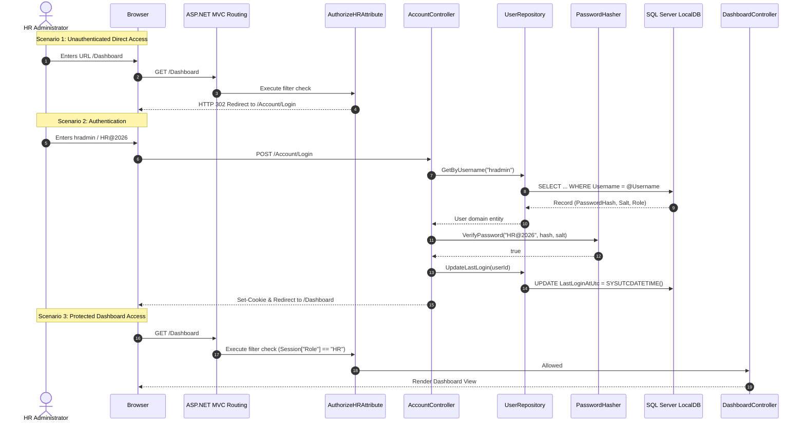

# Phase 1 Implementation Guide — HR Login & Dashboard

## 1. What Was Implemented
- **Clean Project & Database Restart**: Dropped legacy database objects, initialized fresh `RosterraHRDB` database on SQL Server LocalDB (`(localdb)\MSSQLLocalDB`).
- **Minimal Database Architecture for Authentication**: Created `dbo.Users` table with strong integrity constraints (Primary Key, Unique Username, Role Check constraint, UTC timestamping).
- **Secure Initial Administrator Account**: Seeded initial HR admin credentials (`hradmin` / `HR@2026`) using cryptographic PBKDF2 with HMAC-SHA256 and unique 128-bit salt (no plain-text passwords).
- **ADO.NET Connection Factory**: Configured `ConnectionFactory.cs` reading from `Web.config` with proper `SqlConnection` lifecycle management.
- **Data Repository**: Implemented `UserRepository.cs` with parameterized SQL queries preventing SQL injection.
- **Cryptographic Security Service**: Built `PasswordHasher.cs` utilizing `Rfc2898DeriveBytes` (100,000 iterations, SHA-256) and constant-time comparison to prevent timing attacks.
- **Authentication & Session Workflow**: Built `AccountController.cs` providing `Login` (GET/POST) and `Logout` (GET/POST) with `FormsAuthentication` cookie generation and ASP.NET `Session` storage.
- **Server-Side Authorization Filter**: Developed `AuthorizeHRAttribute.cs` enforcing HR role checks on controllers and actions, blocking unauthenticated and unauthorized URL access.
- **HR Dashboard**: Implemented `DashboardController.cs` and `Views/Dashboard/Index.cshtml` displaying authenticated HR administrator greeting, session status, and future module placeholders.
- **UI & Layout**: Created responsive Bootstrap 5 layout (`_Layout.cshtml`, `_ViewStart.cshtml`, `site.css`) and styled `Login.cshtml`.

---

## 2. Why It Was Implemented
- **Security by Design**: Plain-text passwords represent severe security vulnerabilities. Using PBKDF2 SHA-256 with salting ensures credential storage meets enterprise standards.
- **Strict Role-Based Protection**: Direct URL navigation to protected screens must be rejected at the server level. Hiding buttons on the client is insufficient.
- **Separation of Concerns**: Keeping ADO.NET SQL commands isolated in repositories (`UserRepository`) ensures controllers remain lean and testable.
- **Beginner-Friendly Architecture**: Standard ASP.NET MVC 5 on .NET Framework 4.8 without heavy ORMs (like Entity Framework) allows students to understand the exact data and control flows.

---

## 3. Files Involved

| File Path | Role |
| :--- | :--- |
| `ROSTERRA HR/Web.config` | Connection strings and Forms authentication configuration |
| `ROSTERRA HR/Scripts/Database/001_CreateDatabase.sql` | Drops old and creates fresh `RosterraHRDB` |
| `ROSTERRA HR/Scripts/Database/002_CreateUsersTable.sql` | Minimal `Users` DDL with constraints |
| `ROSTERRA HR/Scripts/Database/003_SeedInitialHRAccount.sql` | Seeds `hradmin` with PBKDF2 hash & salt |
| `ROSTERRA HR/Data/ConnectionFactory.cs` | Centralized ADO.NET connection provider |
| `ROSTERRA HR/Security/PasswordHasher.cs` | PBKDF2 SHA-256 hashing and constant-time verification |
| `ROSTERRA HR/Models/User.cs` | Domain entity representing a system user |
| `ROSTERRA HR/Models/LoginViewModel.cs` | View model with `[Required]` data annotations |
| `ROSTERRA HR/Repositories/UserRepository.cs` | Manual ADO.NET database operations with parameterized queries |
| `ROSTERRA HR/Filters/AuthorizeHRAttribute.cs` | Custom authorization filter protecting HR actions |
| `ROSTERRA HR/Controllers/AccountController.cs` | Login and Logout controller actions |
| `ROSTERRA HR/Controllers/DashboardController.cs` | Protected HR dashboard controller |
| `ROSTERRA HR/Controllers/HomeController.cs` | Root route resolution |
| `ROSTERRA HR/App_Start/RouteConfig.cs` | MVC routing table configuration |
| `ROSTERRA HR/Views/Shared/_Layout.cshtml` | Master Bootstrap 5 layout with dynamic auth navbar |
| `ROSTERRA HR/Views/_ViewStart.cshtml` | Global layout definition |
| `ROSTERRA HR/Views/Account/Login.cshtml` | HR login interface |
| `ROSTERRA HR/Views/Dashboard/Index.cshtml` | HR dashboard interface |
| `ROSTERRA HR/Content/site.css` | Custom application stylesheets |

---

## 4. How It Works

### Password Hashing Mechanics
1. When generating credentials, `RNGCryptoServiceProvider` generates 16 bytes (128 bits) of cryptographically secure random salt.
2. `Rfc2898DeriveBytes` executes 100,000 iterations of HMAC-SHA256 to produce a 32-byte (256-bit) key.
3. Both the salt and key are stored as Base64 strings in `dbo.Users`.
4. During verification, the candidate password and stored salt are passed to `Rfc2898DeriveBytes` with identical iterations.
5. The resulting byte array is compared against the stored hash using `SlowEquals` (bitwise XOR comparison), preventing timing side-channel attacks.

### Authentication & Authorization Lifecycle
1. The user inputs their credentials on `/Account/Login`.
2. `AccountController.Login` verifies the model state and calls `UserRepository.GetByUsername`.
3. If found and active, `PasswordHasher.VerifyPassword` checks the password hash.
4. If verified and role is `HR`, an auth ticket cookie is issued (`FormsAuthentication.SetAuthCookie`) and session state is initialized (`Session["Username"] = "hradmin"`, `Session["Role"] = "HR"`).
5. The user is redirected to `/Dashboard`.
6. `DashboardController` is decorated with `[AuthorizeHR]`. The filter verifies the active session role before allowing view execution.
7. If unauthenticated, `AuthorizeHRAttribute` intercepts the request and issues an HTTP 302 redirect to `/Account/Login`.

---

## 5. Database Interactions & DDL

### Table: `dbo.Users`
```sql
CREATE TABLE dbo.Users (
    UserId          INT IDENTITY(1,1) NOT NULL,
    Username        NVARCHAR(50)      NOT NULL,
    PasswordHash    NVARCHAR(256)     NOT NULL,
    PasswordSalt    NVARCHAR(256)     NOT NULL,
    Role            NVARCHAR(20)      NOT NULL CONSTRAINT DF_Users_Role DEFAULT ('HR'),
    IsActive        BIT               NOT NULL CONSTRAINT DF_Users_IsActive DEFAULT (1),
    CreatedAtUtc    DATETIME2         NOT NULL CONSTRAINT DF_Users_CreatedAtUtc DEFAULT (SYSUTCDATETIME()),
    LastLoginAtUtc  DATETIME2         NULL,

    CONSTRAINT PK_Users PRIMARY KEY CLUSTERED (UserId),
    CONSTRAINT UQ_Users_Username UNIQUE (Username),
    CONSTRAINT CK_Users_Role CHECK (Role IN ('HR', 'Employee'))
);
```

### Explanations:
- `UserId`: Auto-incrementing primary key uniquely identifying the account record.
- `Username`: `NVARCHAR(50)` storing login identifier, enforced unique via `UQ_Users_Username`.
- `PasswordHash`: Base64 string of the derived key.
- `PasswordSalt`: Base64 string of the unique per-user salt.
- `Role`: Role descriptor constrained to `'HR'` and `'Employee'`.
- `IsActive`: Soft-disable flag allowing administrative account suspension.
- `CreatedAtUtc`: Auto-populated UTC creation timestamp.
- `LastLoginAtUtc`: Updated upon every successful login via `UserRepository.UpdateLastLogin`.

---

## 6. Request and Execution Flow



---

## 7. How to Test
Execute all 8 required scenarios:
1. **Valid HR Login**: Navigate to `/Account/Login`, enter `hradmin` and `HR@2026`. Verify redirect to `/Dashboard` displaying "Welcome, hradmin".
2. **Incorrect Password**: Enter `hradmin` and an invalid password. Verify "Invalid username or password." error is shown.
3. **Incorrect Username**: Enter `nonexistent_user` and `HR@2026`. Verify generic error is shown.
4. **Empty Username**: Leave username blank, submit form. Verify client/server validation message "Username is required."
5. **Empty Password**: Leave password blank, submit form. Verify validation message "Password is required."
6. **Direct Dashboard URL Access**: In a private/incognito window, directly request `http://localhost:55732/Dashboard`. Verify automatic redirect to `/Account/Login`.
7. **Logout**: Click the "Logout" button on the dashboard. Verify session abandonment and redirect to `/Account/Login`.
8. **Dashboard Access After Logout**: In the same browser, manually navigate back to `/Dashboard`. Verify access is denied and redirected to `/Account/Login`.

---

## 8. Important Technical Concepts
- **PBKDF2 (Password-Based Key Derivation Function 2)**: An adaptive cryptographic key derivation algorithm designed to make brute-force and dictionary attacks computationally expensive.
- **Salt**: Random data added to the password input prior to hashing, ensuring two identical passwords yield distinct hashes and rendering precomputed rainbow tables useless.
- **Timing Attack Mitigation**: Standard string comparisons (`==`) terminate upon the first non-matching byte, leaking timing clues. Bitwise XOR (`SlowEquals`) always takes equal time regardless of where differences occur.
- **Parameterized Queries**: Binding parameters via `command.Parameters.Add("@Username", ...)` treats all input strictly as literal values rather than executable SQL commands, completely neutralizing SQL Injection attacks.

---

## 9. Potential Limitations & Future Hardening
- **Account Lockout Policy**: Current implementation does not lock accounts after repeated failed attempts. An IP/account rate-limiter can be added in Phase 4.
- **Two-Factor Authentication (2FA)**: Currently single-factor password-based.
- **Session Timeout**: Configured for 60 minutes in `Web.config`; could be tailored per enterprise policy.

---

## 10. Viva Questions and Answers

**Q1: Why did you not store passwords using MD5 or SHA-256 directly?**  
*Answer*: Fast cryptographic hashes like MD5 or raw SHA-256 can be computed billions of times per second on modern GPUs, making dictionary and brute-force attacks trivial. PBKDF2 with SHA-256 is an adaptive key-stretching function that incorporates 100,000 iterations and a unique salt, drastically increasing computational cost for attackers while remaining fast for a single legitimate login.

**Q2: What is a timing attack, and how is it prevented in your implementation?**  
*Answer*: In standard string comparison, the comparison stops immediately when the first mismatched character is detected. An attacker measuring execution time in nanoseconds can deduce character by character. We prevent this using `SlowEquals`, which iterates through the entire hash array with bitwise XOR (`diff |= a[i] ^ b[i]`), guaranteeing constant-time execution.

**Q3: How does your application protect against SQL Injection?**  
*Answer*: We never concatenate user inputs into SQL strings. In `UserRepository.cs`, all queries use `SqlCommand.Parameters.Add("@Username", SqlDbType.NVarChar, 50).Value = username`. The database engine compiles the query structure first and treats the parameter value solely as literal data, preventing injection.

**Q4: Why did you implement a custom `AuthorizeHRAttribute` rather than relying on client-side UI hiding?**  
*Answer*: Client-side hiding only prevents regular user clicks, but any user can manually type `/Dashboard` in their browser address bar or use tools like Postman. Server-side authorization via `AuthorizeHRAttribute` inspects every incoming HTTP request on the server and aborts execution if the session lacks the verified HR role.
