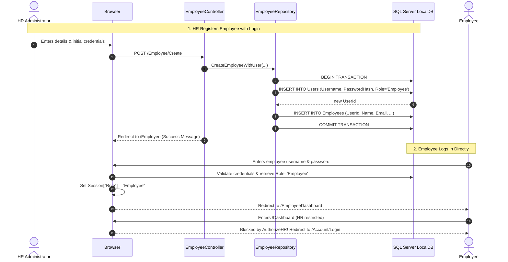

# Phase 2 Implementation Guide — Employee CRUD & Employee Portal

## 1. What Was Implemented
- **Relational Employee Database Schema**: Created `dbo.Employees` with foreign key relationship to `dbo.Users(UserId)`, clustered primary key, unique constraints on `Email` and `UserId`, non-negative salary check constraint, and default constraints.
- **Automated Login Account Provisioning**: When HR registers an employee, an authenticated login account (`Role = 'Employee'`) is atomically created within the same database transaction.
- **Enterprise ADO.NET Architecture**: Implemented `EmployeeRepository.cs` using ADO.NET `SqlConnection`, `SqlCommand`, `SqlDataReader`, and `SqlTransaction` for atomic multi-table operations.
- **Employee CRUD Features for HR**:
  - Directory listing with multi-field search (name, email, designation) and filters (department, active status).
  - Employee creation with duplicate email and username validation.
  - Profile inspection (`Details` view).
  - Profile modification (`Edit` view).
  - Status management (`Deactivate` / `Activate`), which synchronizes both the employee record and user login account.
- **Employee Self-Service Portal**:
  - Built `EmployeeDashboardController.cs` and `Views/EmployeeDashboard/Index.cshtml`.
  - Employees can log in directly with their provisioned credentials.
  - Server-side RBAC: `AuthorizeEmployeeAttribute` grants employees access to their own portal while strictly blocking them from administrative HR pages.
- **Automated Verification**: 14 end-to-end integration tests verifying CRUD, duplicate rejection, transaction safety, direct employee login, and RBAC boundary enforcement.

---

## 2. Why It Was Implemented
- **Business Need**: In an enterprise HR system, employees require self-service portal access while HR staff require workforce management tools.
- **Security & Data Integrity**: Linking each employee record to a credentials row via foreign keys guarantees that only active employees can log in, and that deactivating an employee immediately disables their portal access.
- **Transaction Safety**: Creating an employee profile without their corresponding login account (or vice versa) would lead to orphan records. Using `SqlTransaction` guarantees all-or-nothing atomicity.

---

## 3. Files Involved

| File Path | Role |
| :--- | :--- |
| `ROSTERRA HR/Scripts/Database/004_CreateEmployeesTable.sql` | DDL script for `dbo.Employees` with FK to `dbo.Users` |
| `ROSTERRA HR/Models/Employee.cs` | Core domain entity representing an employee |
| `ROSTERRA HR/Models/EmployeeCreateViewModel.cs` | Model containing registration fields and login credential inputs |
| `ROSTERRA HR/Models/EmployeeEditViewModel.cs` | Model for updating employee profiles |
| `ROSTERRA HR/Repositories/EmployeeRepository.cs` | ADO.NET data access logic with parameterized queries and transactions |
| `ROSTERRA HR/Filters/AuthorizeEmployeeAttribute.cs` | Authorization filter restricting actions to role 'Employee' |
| `ROSTERRA HR/Controllers/EmployeeController.cs` | HR-only controller for Employee CRUD |
| `ROSTERRA HR/Controllers/EmployeeDashboardController.cs` | Employee-only controller for personal portal dashboard |
| `ROSTERRA HR/Controllers/AccountController.cs` | Updated login workflow supporting role-based redirection |
| `ROSTERRA HR/App_Start/RouteConfig.cs` | Centralized MVC route mappings |
| `ROSTERRA HR/Views/Employee/Index.cshtml` | Employee directory and search UI |
| `ROSTERRA HR/Views/Employee/Create.cshtml` | Employee registration form |
| `ROSTERRA HR/Views/Employee/Edit.cshtml` | Employee profile editor |
| `ROSTERRA HR/Views/Employee/Details.cshtml` | Detailed profile view |
| `ROSTERRA HR/Views/EmployeeDashboard/Index.cshtml` | Employee portal self-service dashboard |
| `ROSTERRA HR/Views/Shared/_Layout.cshtml` | Dynamic navigation bar adjusting links based on role |

---

## 4. How It Works

### Atomic Employee Registration
1. HR fills out the registration form at `/Employee/Create`.
2. `EmployeeController.Create` checks for duplicate email or username.
3. `PasswordHasher.CreatePasswordHash` derives a 128-bit salt and 256-bit PBKDF2 SHA-256 hash from the initial password.
4. `EmployeeRepository.CreateEmployeeWithUser` starts a `SqlTransaction`:
   - Inserts record into `dbo.Users (Username, PasswordHash, PasswordSalt, Role = 'Employee', IsActive = 1)`.
   - Obtains generated `UserId` using `SCOPE_IDENTITY()`.
   - Inserts record into `dbo.Employees (UserId, FirstName, LastName, Email, ...)`.
   - Executes `transaction.Commit()`. If an exception occurs, `transaction.Rollback()` prevents partial data insertion.

### Role-Based Access Control (RBAC) Lifecycle
1. When an employee logs in via `/Account/Login`, credentials are verified using `PasswordHasher`.
2. Upon success, session variables are populated (`Session["Role"] = "Employee"`, `Session["UserId"] = <id>`).
3. The user is redirected to `/EmployeeDashboard`.
4. If an employee attempts to navigate to `/Dashboard` or `/Employee`, `[AuthorizeHR]` detects `Session["Role"] != "HR"` and issues an HTTP 302 redirect back to `/Account/Login`.

---

## 5. Database Schema & Relational Structure

```sql
CREATE TABLE dbo.Employees (
    EmployeeId    INT IDENTITY(1,1) NOT NULL,
    UserId        INT               NOT NULL,
    FirstName     NVARCHAR(50)      NOT NULL,
    LastName      NVARCHAR(50)      NOT NULL,
    Email         NVARCHAR(100)     NOT NULL,
    PhoneNumber   NVARCHAR(20)      NULL,
    Department    NVARCHAR(50)      NOT NULL,
    Position      NVARCHAR(50)      NOT NULL,
    Salary        DECIMAL(18,2)     NOT NULL,
    HireDate      DATE              NOT NULL,
    IsActive      BIT               NOT NULL CONSTRAINT DF_Employees_IsActive DEFAULT (1),
    CreatedAtUtc  DATETIME2         NOT NULL CONSTRAINT DF_Employees_CreatedAtUtc DEFAULT (SYSUTCDATETIME()),
    UpdatedAtUtc  DATETIME2         NULL,

    CONSTRAINT PK_Employees PRIMARY KEY CLUSTERED (EmployeeId),
    CONSTRAINT FK_Employees_Users FOREIGN KEY (UserId) REFERENCES dbo.Users(UserId) ON DELETE CASCADE,
    CONSTRAINT UQ_Employees_Email UNIQUE (Email),
    CONSTRAINT UQ_Employees_UserId UNIQUE (UserId),
    CONSTRAINT CK_Employees_Salary CHECK (Salary >= 0)
);
```

---

## 6. Request and Execution Flow



---

## 7. How to Test
Execute the following verification flow:
1. **HR Login**: Log in as `hradmin` / `HR@2026`.
2. **Access Employee Management**: Click "Employees" in navbar or "Open Employee Directory" on Dashboard.
3. **Create Employee**: Click "+ Register New Employee". Enter:
   - First Name: `Alice`, Last Name: `Smith`
   - Email: `alice.smith@rosterra.local`, Phone: `555-0101`
   - Department: `Engineering`, Position: `Senior Developer`
   - Salary: `85000`, Hire Date: `2026-01-15`
   - Username: `asmith`, Password: `Password@2026`
   - Submit form. Verify success alert.
4. **Duplicate Rejection**: Try registering another employee with the same email or username. Verify error banner.
5. **Inspect & Edit**: View details of Alice Smith, then edit designation to `Lead Developer` and salary to `92000`.
6. **Direct Employee Login**:
   - Logout from HR account.
   - Enter `asmith` and `Password@2026` on `/Account/Login`.
   - Verify redirection to `/EmployeeDashboard` with Alice's name and details.
7. **Verify RBAC Barrier**:
   - While signed in as Alice, manually type `http://localhost:55732/Dashboard` in browser.
   - Verify access is blocked and redirected to Login.
8. **Account Deactivation & Lockout**:
   - Log back in as `hradmin`.
   - In Employee Directory, click "Deactivate" next to Alice Smith.
   - Logout and attempt logging in as `asmith`.
   - Verify login is rejected.
