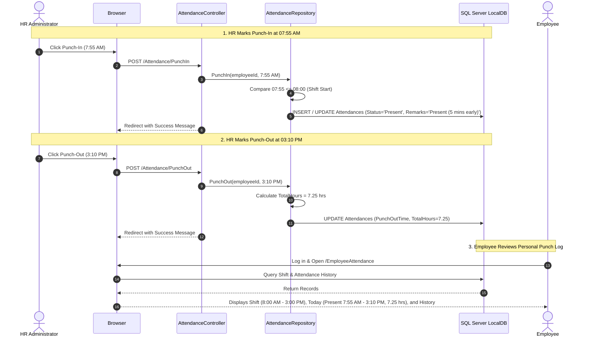

# Shift Management & Attendance Tracking System Guide

## 1. Feature Overview
This module introduces complete workforce schedule building and day-wise attendance tracking using manual ADO.NET and SQL Server LocalDB.

### Key Capabilities:
- **Custom Shift Builder (HR)**: Define custom work schedules with custom names, start times, and end times (e.g. Morning Shift 08:00 AM - 03:00 PM, Night Shift 09:00 PM - 05:00 AM).
- **Shift Assignment (HR)**: Map any employee to an active shift.
- **Punch-In Compliance Engine**:
  - Employee arrives at or before scheduled shift start (e.g. 07:55 AM for 08:00 AM shift) &rarr; Marked **Present (On-Time / Early)**.
  - Employee arrives after scheduled shift start (e.g. 08:10 AM for 08:00 AM shift) &rarr; Marked **Late** with exact calculated late minutes.
  - Employee does not arrive &rarr; Marked **Absent**.
- **Punch-Out & Working Hours Engine**:
  - HR records Punch-Out when employee leaves.
  - System calculates total worked hours and determines full shift completion or early departure.
- **Day-Wise Monitoring Dashboard (HR)**:
  - Filter by date with real-time statistics (Total Active, Present, Late, Absent, Pending).
  - Roster view with punch timestamps, shift hours, and compliance remarks.
- **Employee Self-Service Portal**:
  - Employee views assigned shift name and daily hours.
  - Employee views today's punch status and chronological attendance history log.

---

## 2. Team Split: Files for Teammate (Employee Module)

To allow genuine parallel contributions between Dhruvil and Radhesh:

### Files for Radhesh (Employee Module to commit from his laptop):
These files implement the employee self-service shift schedule and attendance log:
1. `ROSTERRA HR/Models/EmployeeAttendanceLogViewModel.cs`
2. `ROSTERRA HR/Controllers/EmployeeAttendanceController.cs`
3. `ROSTERRA HR/Views/EmployeeAttendance/Index.cshtml`

### Files for Dhruvil (HR Module & Core Foundation):
1. `ROSTERRA HR/Scripts/Database/005_CreateShiftsAndAttendanceTables.sql`
2. `ROSTERRA HR/Scripts/Database/006_SeedDefaultShifts.sql`
3. `ROSTERRA HR/Models/Shift.cs`
4. `ROSTERRA HR/Models/ShiftViewModel.cs`
5. `ROSTERRA HR/Models/ShiftAssignViewModel.cs`
6. `ROSTERRA HR/Models/Attendance.cs`
7. `ROSTERRA HR/Models/AttendanceDayMonitorViewModel.cs`
8. `ROSTERRA HR/Models/AttendanceMarkViewModel.cs`
9. `ROSTERRA HR/Repositories/ShiftRepository.cs`
10. `ROSTERRA HR/Repositories/AttendanceRepository.cs`
11. `ROSTERRA HR/Controllers/ShiftController.cs`
12. `ROSTERRA HR/Controllers/AttendanceController.cs`
13. `ROSTERRA HR/Views/Shift/Index.cshtml`
14. `ROSTERRA HR/Views/Shift/Create.cshtml`
15. `ROSTERRA HR/Views/Shift/Edit.cshtml`
16. `ROSTERRA HR/Views/Shift/Assign.cshtml`
17. `ROSTERRA HR/Views/Attendance/Index.cshtml`
18. `ROSTERRA HR/Views/EmployeeDashboard/Index.cshtml`
19. `ROSTERRA HR/Views/Shared/_Layout.cshtml`
20. `ROSTERRA HR/Views/Employee/Create.cshtml`, `Edit.cshtml`, `Index.cshtml`
21. `ROSTERRA HR/Controllers/EmployeeController.cs`
22. `ROSTERRA HR/Repositories/EmployeeRepository.cs`
23. `ROSTERRA HR/Models/Employee.cs`, `EmployeeCreateViewModel.cs`, `EmployeeEditViewModel.cs`
24. `ROSTERRA HR/App_Start/RouteConfig.cs`
25. `ROSTERRA HR/ROSTERRA HR.csproj`
26. Documentation files.

---

## 3. Database Schema

### Table: `dbo.Shifts`
```sql
CREATE TABLE dbo.Shifts (
    ShiftId        INT IDENTITY(1,1) NOT NULL PRIMARY KEY CLUSTERED,
    ShiftName      NVARCHAR(50)      NOT NULL UNIQUE,
    StartTime      TIME(0)           NOT NULL,
    EndTime        TIME(0)           NOT NULL,
    Description    NVARCHAR(250)     NULL,
    IsActive       BIT               NOT NULL DEFAULT (1),
    CreatedAtUtc   DATETIME2         NOT NULL DEFAULT (SYSUTCDATETIME())
);
```

### Table: `dbo.Attendances`
```sql
CREATE TABLE dbo.Attendances (
    AttendanceId            INT IDENTITY(1,1) NOT NULL PRIMARY KEY CLUSTERED,
    EmployeeId              INT               NOT NULL FOREIGN KEY REFERENCES dbo.Employees(EmployeeId),
    ShiftId                 INT               NOT NULL FOREIGN KEY REFERENCES dbo.Shifts(ShiftId),
    AttendanceDate          DATE              NOT NULL,
    PunchInTime             DATETIME2         NULL,
    PunchOutTime            DATETIME2         NULL,
    Status                  NVARCHAR(20)      NOT NULL CHECK (Status IN ('Present', 'Late', 'Absent', 'Pending')),
    ShiftStartTimeSnapshot  TIME(0)           NOT NULL,
    ShiftEndTimeSnapshot    TIME(0)           NOT NULL,
    TotalHours              DECIMAL(5,2)      NULL,
    Remarks                 NVARCHAR(250)     NULL,
    MarkedByUserId          INT               NOT NULL FOREIGN KEY REFERENCES dbo.Users(UserId),
    CreatedAtUtc            DATETIME2         NOT NULL DEFAULT (SYSUTCDATETIME()),
    UpdatedAtUtc            DATETIME2         NULL,

    CONSTRAINT UQ_Attendances_Employee_Date UNIQUE (EmployeeId, AttendanceDate)
);
```

---

## 4. Execution and Verification Flow


